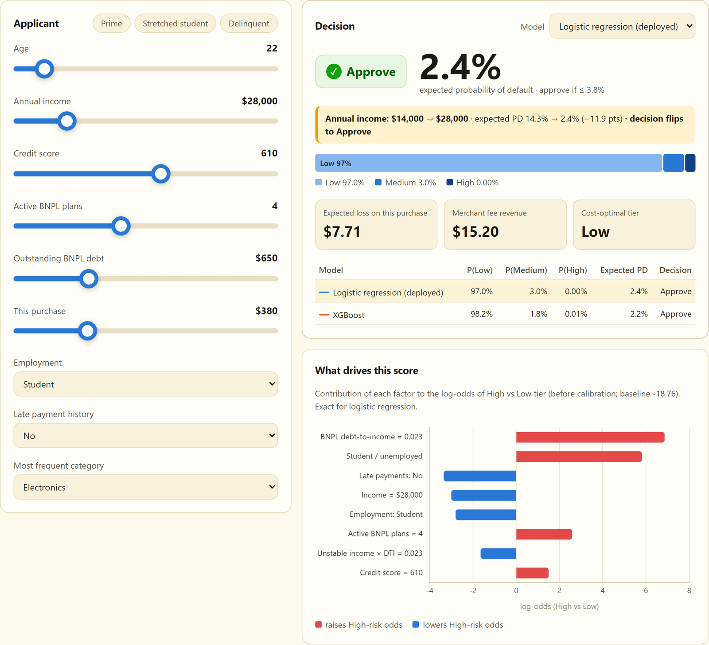
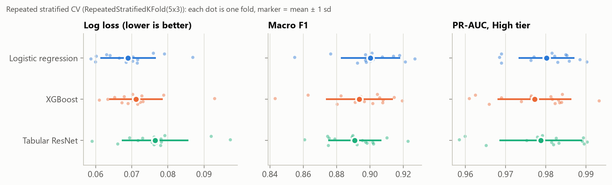
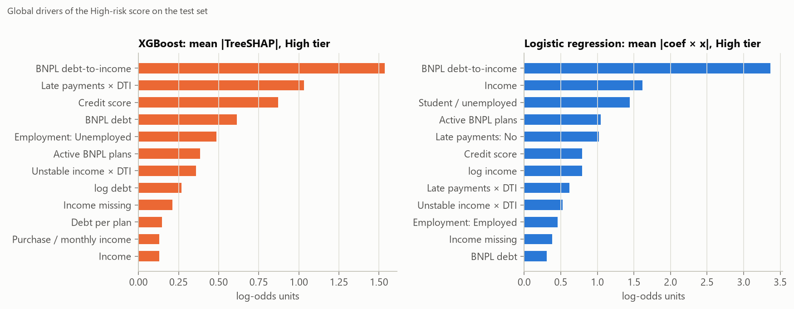
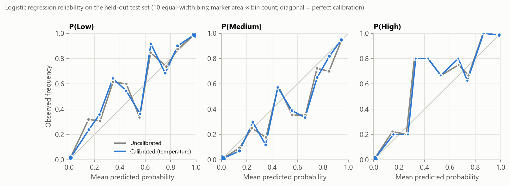
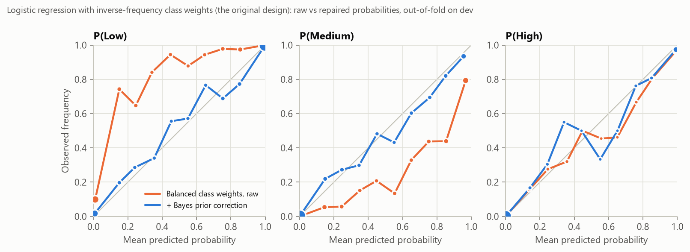
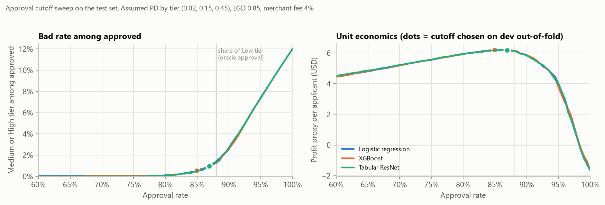

# BNPL Default Risk

[](https://github.com/alexkeranis/Default-Risk-Interactive-Predictor/actions/workflows/tests.yml)

A Buy Now, Pay Later provider has to decide at checkout whether to finance a purchase.
This project estimates each applicant's probability of falling into a Low, Medium or High default-risk
tier, calibrates those probabilities, and turns them into an approve/decline decision under explicit unit
economics. One scikit-learn pipeline covers training, cross-validation, and batch and single-record scoring.

This repository has its own interactive web page, built by GitHub Actions and hosted on GitHub Pages:
[alexkeranis.github.io/Default-Risk-Interactive-Predictor](https://alexkeranis.github.io/Default-Risk-Interactive-Predictor/)

[](https://alexkeranis.github.io/Default-Risk-Interactive-Predictor/)

The model runs in the browser. In the capture above, doubling a student's income from $14,000 to $28,000
drops the expected probability of default from 14.3% to 2.4% and the decision flips to Approve.

> **The data is synthetic.** The labels follow a near-deterministic rule (a depth-4 decision tree reaches
> 0.84 macro F1), so the numbers below are a benchmark on a synthetic generator and say little about
> real-world credit performance. See [Dataset and limitations](#dataset-and-limitations).

## Results

Development set: 8,000 rows, repeated stratified 5×3 CV, mean ± sd over 15 folds. Held-out test set:
2,000 rows (104 High), scored **once**, with stratified-bootstrap 95% CIs. Every family had the same
tuning budget, tuned by inner CV on log loss.

| Model | CV log loss | CV Brier | CV macro F1 | CV PR-AUC (High) | Test macro F1 [95% CI] | Test recall High [95% CI] | Test ECE High |
|---|---|---|---|---|---|---|---|
| **Logistic regression** (deployed) | **0.069 ± 0.008** | 0.041 ± 0.006 | 0.900 ± 0.018 | 0.980 ± 0.007 | 0.885 [0.859, 0.909] | 0.885 [0.827, 0.942] | 0.003 |
| XGBoost | 0.071 ± 0.007 | 0.042 ± 0.005 | 0.894 ± 0.020 | 0.977 ± 0.009 | 0.884 [0.855, 0.910] | 0.837 [0.760, 0.904] | 0.005 |
| Tabular ResNet (PyTorch) | 0.076 ± 0.009 | 0.045 ± 0.006 | 0.891 ± 0.016 | 0.979 ± 0.010 | 0.888 [0.861, 0.914] | 0.875 [0.808, 0.942] | 0.005 |

- The three families are statistically tied on macro F1. No pairwise difference is significant
  (Nadeau–Bengio corrected t-test, p ≥ 0.19).
- On log loss, logistic regression and XGBoost both beat the ResNet (p = 0.003 and p = 0.035) and are tied
  with each other (p = 0.36).
- The pre-registered selection rule (simplest model within one corrected SE of the best log loss) deploys
  **logistic regression**.
- Test CIs are about ±0.025 macro F1 wide. Any single-split claim tighter than that is noise.

Full tables (per-class metrics, paired tests, calibration, ablations, decisions) are in
[`reports/benchmark.md`](reports/benchmark.md).



## Key risk drivers

Exact attributions on the test set (logistic regression: coefficient × standardised value; XGBoost: TreeSHAP),
confirmed by model-agnostic permutation importance:

1. **BNPL debt-to-income** is the dominant driver for every model.
2. **Income** and **outstanding BNPL debt** individually: shuffling either raises test log loss by ~0.5–1.1.
3. **Late payment history**, especially interacted with leverage (`late × DTI`).
4. **Unstable income** (student / unemployed), alone and interacted with leverage.
5. **Number of active plans** and **credit score**: secondary.

Age, purchase size and shopping category carry ~zero signal (permutation importance ≈ 0). That is consistent
with a synthetic generator that ignores them.



## Method

### Pipeline (one object, fit inside every fold)

```
raw inputs ─► schema validation ─► median imputation + missing flags ─► domain features
           ─► encoding (scale / one-hot / ordinal) ─► model ─► post-hoc calibration ─► decision layer
```

The fitted object is serialized once and used for CV, the test evaluation, batch scoring, single-record
scoring and the browser export. There is no second implementation of preprocessing to drift. Training data
passes the same schema gate as live traffic, so even dtypes match.

### Engineered features

All features are stateless row-wise functions, so they cannot leak across folds.

| Feature | Definition | Financial rationale |
|---|---|---|
| `bnpl_dti` | debt / max(income, $5k) | Core affordability and leverage. Income is floored, so zero income means *maximum* leverage, never zero. |
| `ticket_to_monthly_income` | purchase / (income / 12) | Size of each new plan relative to the cash flow that services it. |
| `debt_per_loan` | debt / active plans (0 if none) | A few large commitments vs many small ones. |
| `loan_stacking` | active plans ≥ 3 | BNPL stacking across providers, a stress signal bureaus often miss. |
| `subprime`, `near_prime` | score < 580; 580–669 | FICO band thresholds a linear model cannot learn from the raw score. |
| `unstable_income` | student or unemployed | Irregular or transfer-based income. |
| `late_x_dti`, `unstable_x_dti`, `late_x_subprime` | interactions | Delinquency and unstable income matter more for already-stretched borrowers. |
| `log_income`, `log_debt` | log1p | Diminishing marginal effects. |
| `young_borrower` | age < 25 | Thin-file proxy. |

Ablation on identical folds, comparing raw inputs with engineered features: logistic-regression log loss
improves from 0.115 to **0.069** (p < 0.001) and XGBoost from 0.085 to **0.071** (p < 0.001). Feature
engineering matters most for the linear model, as expected. KNN imputation is no better than median
imputation: missingness is ~3% and missing completely at random (MCAR). The categorical inputs are essential:
a fixed-configuration XGBoost scores **0.792 ± 0.019** macro F1 on numeric inputs alone and **0.886 ± 0.016**
with employment status and late-payment history added.

### Calibration

The calibration method (none, sigmoid, isotonic or temperature) is chosen per family by out-of-fold Brier score.

The tuned models are already well calibrated. Tuning on log loss selected no class weights for any family,
and the chosen temperature scaling is close to the identity (fitted β 0.94 for logistic regression, 1.06 for
XGBoost). It changes test log loss and Brier score by less than 0.001 in either direction, which is far
inside the bootstrap intervals, and it cannot change the predicted tier, so F1 and recall are identical with
and without it. Test ECE for the High tier is 0.003.

Class-weighted training is different. Inverse-frequency class weights make the implied priors uniform. The
[benchmark](reports/benchmark.md#class-weighted-training-and-probability-repair) shows that a temperature
cannot undo this and that one-vs-rest sigmoid/isotonic on a multinomial model makes it worse. Only the
analytic Bayes prior correction (p ∝ p_w · π / π_w) restores calibrated probabilities:

- out-of-fold Brier 0.070 → **0.042**
- mean P(Medium) 0.105 → **0.068**, the observed base rate
- Medium ECE 0.037 → **0.003**

In short, training with a proper scoring rule and handling class asymmetry in the decision layer works
better than reweighting the loss.



Mid-range bins are sparse: the model is confident for most applicants, so only a few dozen of the 2,000 test
rows fall between 0.3 and 0.7 (marker area ∝ bin count). Read the zig-zags there as sampling noise.



### Cost-sensitive decisions

The labels are risk tiers, not observed defaults. Converting them to money requires explicit assumptions,
set in `config.CostAssumptions` and editable on the web page:

- Assumed PD by tier: Low 2%, Medium 15%, High 45%.
- LGD 85%, merchant fee 4% of the purchase, exposure = purchase value.

**Approval rule:** approve if the expected PD (Σₖ pₖ · PDₖ) ≤ cutoff. The cutoff maximises a profit proxy on
*out-of-fold development* predictions, never on the test set.
**Tier rule:** assign the tier with the lowest expected misclassification cost, argminⱼ Σₖ pₖ C[k, j], where
under-calling risk costs more than over-calling it.

| Policy (test set) | Approval rate | High tier among approved | Medium+High among approved | Profit proxy / applicant |
|---|---|---|---|---|
| Approve everyone | 100% | 5.20% | 12.0% | −$1.65 |
| **Logistic regression, cutoff 3.8%** | **84.9%** | **0.00%** | **0.47%** | **$6.20** |
| Oracle (true tier known) | 88.0% | 0.00% | 0.00% | $6.56 |

The cost-optimal tier rule lowers expected misclassification cost from 0.095 to **0.065** per applicant,
compared with argmax.



### Choice of metrics

- Errors are asymmetric. Approving a High-risk applicant loses several times what declining a Low-risk one
  gives up, while macro F1 at argmax weights both errors equally. Decisions therefore use a cost model.
- Pricing, limits and provisioning use the probabilities themselves. A classifier with good F1 can still
  produce badly miscalibrated PDs, as class-weighted training does, so log loss, Brier score and
  reliability curves are reported alongside F1.
- With 5% High, a model that approves everyone is 88% accurate. Per-class precision, recall and PR-AUC
  on the High tier are reported for this reason.
- A test macro F1 interval about ±0.025 wide means single-split differences of a few points are noise.
  Model comparisons rely on repeated CV with a corrected t-test.

## Dataset and limitations

**Source:** [Kaggle: Buy Now Pay Later (BNPL) Default Risk](https://www.kaggle.com/datasets/itzzomkar/buy-now-pay-later-bnpl-default-risk/data),
10,000 rows, 9 inputs, target `Default_Risk` ∈ {Low 88.0%, Medium 6.8%, High 5.2%}. The file is committed
at `data/` and its SHA-256 is recorded in `models/model_meta.json`.

- **Synthetic, rule-like labels.** Median High-tier DTI is 15× the Low-tier median, and a depth-4 tree
  reaches 0.84 macro F1 (`notebooks/01_eda.ipynb`). Real bureau data is far noisier, so expect much lower
  separation in practice.
- **Generator artifacts.** Income is censored at exactly $5,000. Missing income and credit score (~3%) are
  missing completely at random (MCAR). Age, purchase size and category have no effect.
- **Tiers ≠ defaults.** Every dollar figure depends on the assumed PD per tier and on LGD.
- **No time dimension.** There are no vintages, so no out-of-time validation and no drift monitoring.
- **Fairness has not been assessed.** Age and employment status are protected or sensitive attributes in
  many jurisdictions (for example ECOA/Reg B in the US). Any real use would require a disparate-impact review
  and adverse-action reason codes. The per-applicant attributions are a starting point for the latter.

## Reproduce

```bash
python -m venv .venv && source .venv/bin/activate        # Windows: .venv\Scripts\activate
pip install torch==2.7.1 --index-url https://download.pytorch.org/whl/cpu   # deterministic CPU build
pip install -r requirements-dev.txt && pip install -e . --no-deps

python -m bnpl_risk.train        # tune, CV, calibrate, test once, write models/ + reports/  (~6 min, 16 cores)
python -m bnpl_risk.reporting    # reports/benchmark.md + reports/figures/*.png
python -m bnpl_risk.export_web   # docs/data/*.json for the web page
```

Everything is seeded (`bnpl_risk.seed.seed_everything`: Python, NumPy, torch deterministic algorithms, CPU),
and two full runs produce identical metrics. `python -m bnpl_risk.train --fast` is a 2-minute smoke run that
writes to `models/_fast/` and `reports/_fast/`.

### Scoring

```bash
# Batch: invalid rows are kept and marked REJECTED_INPUT with a reason; out-of-range values are flagged
python -m bnpl_risk.inference --csv customers.csv            # -> customers_scored.csv  (--strict to fail fast)

# Single applicant
python -m bnpl_risk.inference --json '{"Age": 22, "Income_USD": 14000, "Credit_Score": 610,
  "Total_BNPL_Active_Loans": 4, "Total_BNPL_Debt_USD": 650, "Average_Transaction_Value_USD": 380,
  "Employment_Status": "Student", "Late_Payment_History": "No", "Shopping_Category_Most_Frequent": "Electronics"}'
```

The output contains `Prob_Low/Medium/High`, `Expected_PD`, `Expected_Loss_USD`, `Risk_Tier` (cost-optimal),
`Decision`, `OOD_Flags` and `Errors`.
- **Rejected (hard errors):** missing columns, non-numeric values, unknown categories, and out-of-range
  values such as a credit score of 900 or negative debt.
- **Imputed:** missing income or credit score, exactly as in training.
- **Scored but flagged:** values outside the training support.

`models/model_meta.json` documents the deployed model without unpickling anything. It holds the data hash,
split, feature schema and training-support ranges, hyperparameters, CV and test metrics with CIs,
calibration curves, the decision cutoff and cost assumptions, library versions, and the git revision.

## Tests and CI

```bash
ruff check . && ruff format --check .
pytest -q                                  # 71 tests, ~12 s, no trained artifacts needed
node --test docs/tests/parity.test.mjs     # browser model == Python pipeline
```

| Test file | What it guarantees |
|---|---|
| `test_leakage.py` | Fitted statistics equal train-only statistics; a spy estimator proves CV never trains on validation rows; dev/test are disjoint and the committed split matches the code. |
| `test_parity.py` | Serving features equal training-pipeline features; single = batch = CLI output; row-order independence; invalid rows are rejected without affecting neighbours. |
| `test_schema.py` | Every malformed or out-of-range input fails with a specific message; nullable fields are imputed; out-of-support values are flagged. |
| `test_determinism.py` | Two seeded fits give bit-identical probabilities (LR, XGBoost, ResNet); pickling round-trips. |
| `test_probabilities.py` | Probabilities are in [0, 1] and rows sum to 1 (atol 1e-9) before and after calibration; decision columns are internally consistent. |
| `test_features.py` | Hand-computed feature values; zero income maps to maximum leverage; no inf/NaN; the transformer is stateless. |
| `test_export.py` | The JSON exported for the browser reproduces every calibration method for LR (1e-9) and XGBoost (1e-5, float32 accumulation). |

[`.github/workflows/tests.yml`](.github/workflows/tests.yml) runs lint, pytest (CPU torch) and the Node
parity test on every push and pull request. [`.github/workflows/pages.yml`](.github/workflows/pages.yml)
rebuilds the web page from a clean checkout on every push to `main` (or a manual run) and deploys it to GitHub
Pages. Each asset URL is stamped with the commit hash, so a deploy never serves stale JS, CSS or data.

## Web page

[`docs/`](docs/) is a static site with no server: HTML/CSS, Chart.js and a 200-line JS scoring module that
reads JSON exported from the fitted pipelines. It is published at
[alexkeranis.github.io/Default-Risk-Interactive-Predictor](https://alexkeranis.github.io/Default-Risk-Interactive-Predictor/).

- Underwriting simulator: sliders bounded to the training support, live tier probabilities, expected PD
  and loss, the approve/decline decision and signed per-applicant risk drivers. You can switch between
  logistic regression and XGBoost and edit the cost assumptions.
- Diagnostics: the benchmark table, global drivers, and a cutoff slider that recomputes approval rate,
  bad rate and profit on the test set.

To run it locally, use `python -m http.server -d docs` and open http://localhost:8000. Browsers block
`fetch` from `file://`, so opening the HTML file directly won't load the data.

## Project layout

```
src/bnpl_risk/
  config.py         paths, schema, experiment design, cost assumptions
  schema.py         input contract: hard errors, nullable fields, out-of-support flags
  data.py           loading, SHA-256, one-time stratified dev/test split
  features.py       stateless financial feature engineering (+ rationale)
  preprocessing.py  imputer, encoders, the single pipeline builder
  models/           logistic regression, XGBoost wrapper, tabular ResNet (sklearn API)
  tuning.py         equal-budget search, log-loss scoring
  evaluation.py     metrics, ECE, bootstrap CIs, corrected t-test, prior correction, decision economics
  explain.py        TreeSHAP, linear contributions, permutation importance
  train.py          end-to-end experiment
  inference.py      RiskScorer + CLI
  reporting.py      benchmark.md + figures
  export_web.py     JSON export + Python reference evaluator for the browser model
tests/              pytest suite
docs/               static web page (GitHub Pages)
notebooks/          01_eda (dev split only), 02_benchmark_report (reads artifacts, trains nothing)
reports/            benchmark.md, figures, CV/tuning logs, split indices
models/             model_meta.json (committed); *.joblib regenerated by training
```

## License

MIT. See [`LICENSE`](LICENSE).
