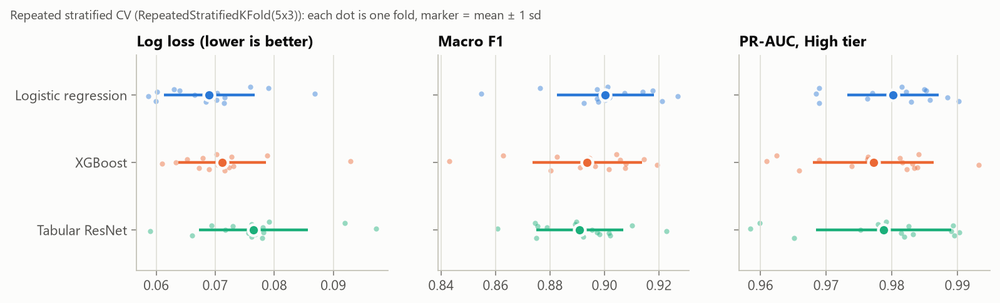
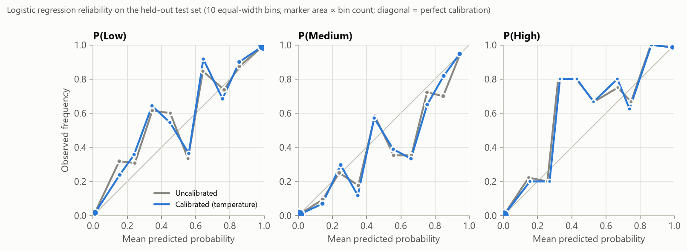
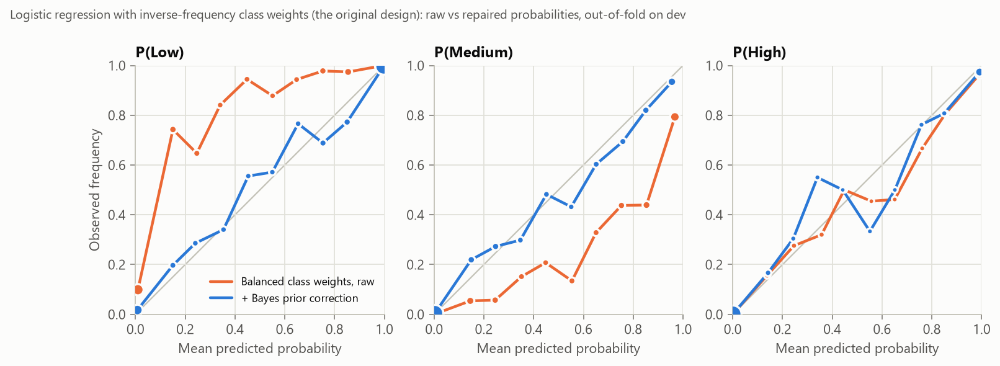
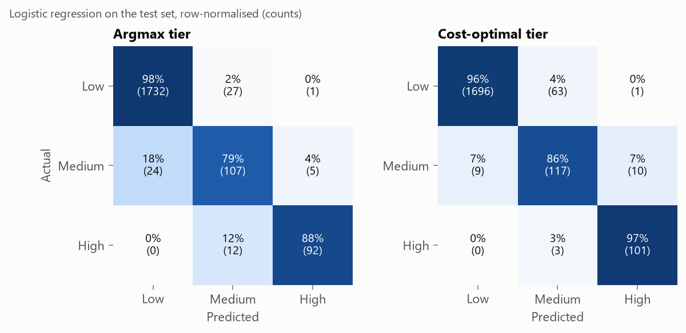
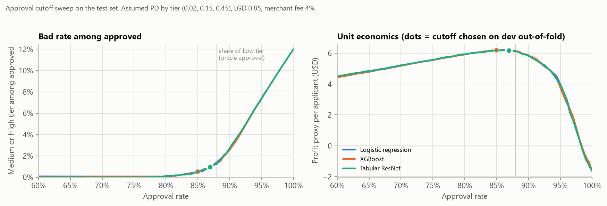
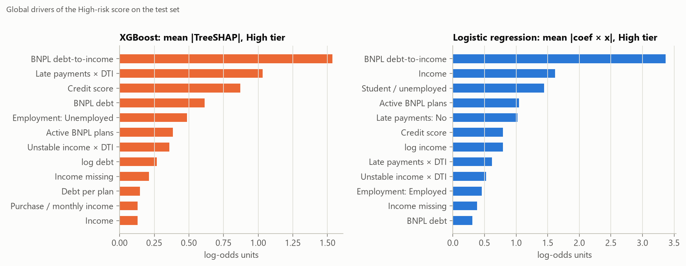

# Benchmark report

Generated by `python -m bnpl_risk.train` + `python -m bnpl_risk.reporting`. Data sha256 `7acc0af1518d3901…`, seed 42, dev n = 8000, held-out test n = 2000 (class counts [1760, 136, 104] for Low/Medium/High). Git revision `875b381d9dac47128f121260d0836e6a70899f8a-dirty`.

## Protocol

- Every family is tuned with the same inner 5-fold CV on the development set only, scored by **log loss**: 24-point grid for logistic regression, 30 random-search draws each for XGBoost and the tabular ResNet.
- Tuned configurations are then compared on identical folds: RepeatedStratifiedKFold(5x3). Paired differences use the Nadeau–Bengio corrected resampled t-test.
- Calibration method (none / sigmoid / isotonic / temperature) is chosen per family by out-of-fold Brier score; decision cutoffs are chosen on out-of-fold development predictions.
- The test set is scored once, at the end. 95% CIs: stratified bootstrap, 1000 resamples.

## Cross-validated performance (dev, mean ± sd over folds, uncalibrated)

| Model | Log loss | Brier | Macro F1 | ROC-AUC (macro) | PR-AUC (macro) | PR-AUC High | Recall High | Precision High |
|---|---|---|---|---|---|---|---|---|
| Logistic regression **(selected)** | 0.0690 ± 0.0076 | 0.0414 ± 0.0057 | 0.900 ± 0.018 | 0.9949 ± 0.0011 | 0.951 ± 0.012 | 0.980 ± 0.007 | 0.910 ± 0.041 | 0.928 ± 0.026 |
| XGBoost | 0.0712 ± 0.0074 | 0.0423 ± 0.0051 | 0.894 ± 0.020 | 0.9945 ± 0.0012 | 0.944 ± 0.010 | 0.977 ± 0.009 | 0.887 ± 0.038 | 0.941 ± 0.028 |
| Tabular ResNet | 0.0764 ± 0.0092 | 0.0445 ± 0.0060 | 0.891 ± 0.016 | 0.9942 ± 0.0013 | 0.947 ± 0.013 | 0.979 ± 0.010 | 0.926 ± 0.028 | 0.904 ± 0.044 |

Selection rule: lowest mean CV log loss; simplest family within 1 corrected SE of the best. Best by log loss: **Logistic regression**; threshold 0.0733 (corrected SE 0.0043); eligible: Logistic regression, XGBoost; selected: **Logistic regression**.

### Paired comparisons (corrected t-test over the CV folds)

| A | B | Metric | Mean(A − B) | t | p |
|---|---|---|---|---|---|
| Logistic regression | XGBoost | log_loss | -0.0022 | -0.95 | 0.359 |
| Logistic regression | XGBoost | macro_f1 | +0.0066 | 1.11 | 0.284 |
| Logistic regression | XGBoost | brier | -0.0009 | -0.63 | 0.540 |
| Logistic regression | XGBoost | pr_auc_High | +0.0030 | 1.23 | 0.239 |
| Logistic regression | Tabular ResNet | log_loss | -0.0074 | -3.64 | 0.003 |
| Logistic regression | Tabular ResNet | macro_f1 | +0.0094 | 1.38 | 0.188 |
| Logistic regression | Tabular ResNet | brier | -0.0031 | -2.22 | 0.044 |
| Logistic regression | Tabular ResNet | pr_auc_High | +0.0014 | 0.47 | 0.642 |
| XGBoost | Tabular ResNet | log_loss | -0.0053 | -2.33 | 0.035 |
| XGBoost | Tabular ResNet | macro_f1 | +0.0028 | 0.29 | 0.774 |
| XGBoost | Tabular ResNet | brier | -0.0021 | -1.11 | 0.285 |
| XGBoost | Tabular ResNet | pr_auc_High | -0.0016 | -0.54 | 0.598 |
| logreg/raw_features | Logistic regression | log_loss | +0.0458 | 10.08 | 0.000 |
| logreg/knn_imputer | Logistic regression | log_loss | +0.0023 | 1.23 | 0.238 |
| xgboost/raw_features | XGBoost | log_loss | +0.0138 | 6.20 | 0.000 |
| xgboost/knn_imputer | XGBoost | log_loss | +0.0021 | 2.02 | 0.063 |

## Held-out test set (calibrated, point estimate [95% bootstrap CI])

| Model | Calibration | Log loss | Brier | Macro F1 | PR-AUC High | Recall High | Precision High | ECE High |
|---|---|---|---|---|---|---|---|---|
| Logistic regression | temperature | 0.0786 [0.0648, 0.0953] | 0.0464 [0.0382, 0.0558] | 0.885 [0.859, 0.909] | 0.983 [0.966, 0.994] | 0.885 [0.827, 0.942] | 0.939 [0.890, 0.980] | 0.003 [0.000, 0.005] |
| XGBoost | temperature | 0.0792 [0.0665, 0.0946] | 0.0473 [0.0391, 0.0571] | 0.884 [0.855, 0.910] | 0.982 [0.965, 0.993] | 0.837 [0.760, 0.904] | 0.967 [0.926, 1.000] | 0.005 [0.002, 0.008] |
| Tabular ResNet | temperature | 0.0824 [0.0673, 0.0993] | 0.0474 [0.0389, 0.0574] | 0.888 [0.861, 0.914] | 0.983 [0.969, 0.994] | 0.875 [0.808, 0.942] | 0.938 [0.890, 0.979] | 0.005 [0.002, 0.008] |

Per-class test metrics, selected model (calibrated, argmax):

| Tier | Precision | Recall | F1 | PR-AUC (OvR) | ROC-AUC (OvR) | ECE |
|---|---|---|---|---|---|---|
| Low | 0.986 | 0.984 | 0.985 | 0.999 | 0.9941 | 0.0053 |
| Medium | 0.733 | 0.787 | 0.759 | 0.862 | 0.9851 | 0.0078 |
| High | 0.939 | 0.885 | 0.911 | 0.983 | 0.9991 | 0.0026 |

## Calibration (out-of-fold on dev)

| Model | Method | Brier | Log loss | ECE Low | ECE Medium | ECE High |
|---|---|---|---|---|---|---|
| Logistic regression | none | 0.0411 | 0.0684 | 0.0011 | 0.0031 | 0.0003 |
| Logistic regression | sigmoid | 0.0752 | 0.1460 | 0.0463 | 0.0542 | 0.0104 |
| Logistic regression | isotonic | 0.0694 | 0.1401 | 0.0309 | 0.0360 | 0.0059 |
| Logistic regression | temperature ✔ | 0.0410 | 0.0683 | 0.0014 | 0.0015 | 0.0005 |
| XGBoost | none | 0.0424 | 0.0710 | 0.0020 | 0.0015 | 0.0008 |
| XGBoost | sigmoid | 0.0467 | 0.0946 | 0.0180 | 0.0107 | 0.0062 |
| XGBoost | isotonic | 0.0428 | 0.0818 | 0.0009 | 0.0026 | 0.0005 |
| XGBoost | temperature ✔ | 0.0424 | 0.0707 | 0.0021 | 0.0014 | 0.0008 |
| Tabular ResNet | none | 0.0458 | 0.0779 | 0.0062 | 0.0058 | 0.0035 |
| Tabular ResNet | sigmoid | 0.0489 | 0.1003 | 0.0126 | 0.0140 | 0.0034 |
| Tabular ResNet | isotonic | 0.0458 | 0.0836 | 0.0061 | 0.0045 | 0.0017 |
| Tabular ResNet | temperature ✔ | 0.0457 | 0.0779 | 0.0065 | 0.0057 | 0.0036 |

### Repairing class-weighted probabilities (the original design)

Same logistic regression, `class_weight='balanced'`, out-of-fold on dev. Inverse-frequency weights make the implied class priors uniform, so raw probabilities overstate Medium risk and understate Low. Findings: one temperature cannot shift class priors; one-vs-rest sigmoid/isotonic on a multinomial model's decision function are actively harmful (each column is calibrated in isolation although softmax logits are only defined up to a shared shift); the analytic Bayes prior correction p ∝ p_w · π/π_w restores both calibration and the base rates. The cleaner fix, used by the deployed pipeline, is upstream: tuning on log loss selected *no* class weights for every family, and class asymmetry is handled in the decision layer (cost matrix, cutoff).

| Variant | Brier | Log loss | ECE Medium | ECE High | Mean P(Medium) | Mean P(High) | Macro F1 | Recall High |
|---|---|---|---|---|---|---|---|---|
| balanced weights, uncalibrated | 0.0703 | 0.1203 | 0.0373 | 0.0020 | 0.105 | 0.054 | 0.871 | 0.916 |
| balanced weights + sigmoid | 0.0837 | 0.1670 | 0.0785 | 0.0141 | 0.075 | 0.066 | 0.690 | 0.993 |
| balanced weights + isotonic | 0.0784 | 0.1585 | 0.0649 | 0.0104 | 0.074 | 0.062 | 0.734 | 0.981 |
| balanced weights + temperature | 0.0674 | 0.1122 | 0.0413 | 0.0030 | 0.109 | 0.055 | 0.871 | 0.916 |
| balanced weights + Bayes prior correction ✔ | 0.0423 | 0.0713 | 0.0032 | 0.0005 | 0.068 | 0.052 | 0.896 | 0.909 |
| *observed base rate* | | | | | 0.068 | 0.052 | | |

## Ablations (same folds)

| Variant | Log loss | Macro F1 | PR-AUC High |
|---|---|---|---|
| Logistic regression: engineered features, median imputation (baseline) | 0.0690 ± 0.0076 | 0.900 ± 0.018 | 0.980 ± 0.007 |
| Logistic regression: raw features only | 0.1148 ± 0.0103 | 0.853 ± 0.017 | 0.952 ± 0.018 |
| Logistic regression: KNN imputation | 0.0713 ± 0.0071 | 0.899 ± 0.017 | 0.978 ± 0.008 |
| XGBoost: engineered features, median imputation (baseline) | 0.0712 ± 0.0074 | 0.894 ± 0.020 | 0.977 ± 0.009 |
| XGBoost: raw features only | 0.0849 ± 0.0053 | 0.875 ± 0.011 | 0.972 ± 0.009 |
| XGBoost: KNN imputation | 0.0733 ± 0.0068 | 0.890 ± 0.018 | 0.975 ± 0.009 |
| Original XGBoost config, numeric features only (as in the old notebook) | 0.1732 ± 0.0169 | 0.792 ± 0.019 | 0.927 ± 0.017 |
| Original XGBoost config, with categorical features | 0.0944 ± 0.0131 | 0.886 ± 0.016 | 0.972 ± 0.011 |

## Cost-sensitive decisions (test set; cutoff chosen on dev out-of-fold predictions)

Assumptions (illustrative, configurable in `config.CostAssumptions`): PD by tier (0.02, 0.15, 0.45), LGD 0.85, merchant fee 4% of purchase value, exposure = average transaction value. Break-even PD = fee / LGD = 0.047.

| Policy | PD cutoff | Approval rate | High share of approved | Medium+High share of approved | High tier declined | Profit proxy / applicant | Misclass. cost (argmax → Bayes) |
|---|---|---|---|---|---|---|---|
| Logistic regression | 0.0381 | 84.9% | 0.00% | 0.47% | 100.0% | $6.20 | 0.095 → 0.065 |
| XGBoost | 0.0379 | 85.0% | 0.00% | 0.53% | 100.0% | $6.20 | 0.098 → 0.076 |
| Tabular ResNet | 0.0528 | 86.9% | 0.00% | 0.98% | 100.0% | $6.17 | 0.092 → 0.071 |
| Approve everyone | 1.0000 | 100.0% | 5.20% | 12.00% | 0.0% | $-1.65 | 0.000 → 0.000 |
| Oracle (true tier known) | n/a | 88.0% | 0.00% | 0.00% | 100.0% | $6.56 | 0.000 → 0.000 |

## Feature importance (test set)

| Rank | XGBoost mean abs TreeSHAP (High) | Logistic regression mean abs coef × x (High) |
|---|---|---|
| 1 | BNPL debt-to-income (1.535) | BNPL debt-to-income (3.365) |
| 2 | Late payments × DTI (1.033) | Income (1.615) |
| 3 | Credit score (0.871) | Student / unemployed (1.446) |
| 4 | BNPL debt (0.614) | Active BNPL plans (1.045) |
| 5 | Employment: Unemployed (0.486) | Late payments: No (1.023) |
| 6 | Active BNPL plans (0.384) | Credit score (0.793) |
| 7 | Unstable income × DTI (0.360) | log income (0.789) |
| 8 | log debt (0.269) | Late payments × DTI (0.617) |
| 9 | Income missing (0.213) | Unstable income × DTI (0.524) |
| 10 | Debt per plan (0.147) | Employment: Employed (0.454) |

Permutation importance on raw inputs (increase in test log loss when shuffled):

| Input | Logistic regression | XGBoost | Tabular ResNet |
|---|---|---|---|
| Income_USD | 1.0790 | 0.6113 | 0.6117 |
| Total_BNPL_Debt_USD | 1.0226 | 0.7083 | 0.5135 |
| Late_Payment_History | 0.1754 | 0.1638 | 0.2290 |
| Total_BNPL_Active_Loans | 0.0714 | 0.0228 | 0.0409 |
| Employment_Status | 0.0495 | 0.0288 | 0.0466 |
| Credit_Score | 0.0268 | 0.0196 | 0.0275 |
| Average_Transaction_Value_USD | 0.0009 | 0.0005 | 0.0042 |
| Age | 0.0004 | -0.0013 | -0.0015 |
| Shopping_Category_Most_Frequent | -0.0011 | -0.0000 | 0.0024 |

## Figures

